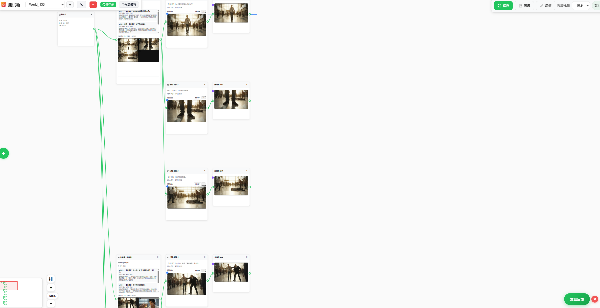
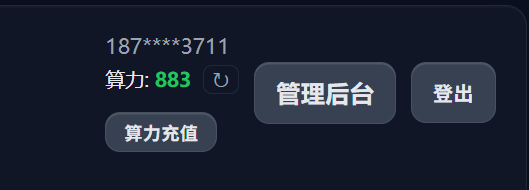
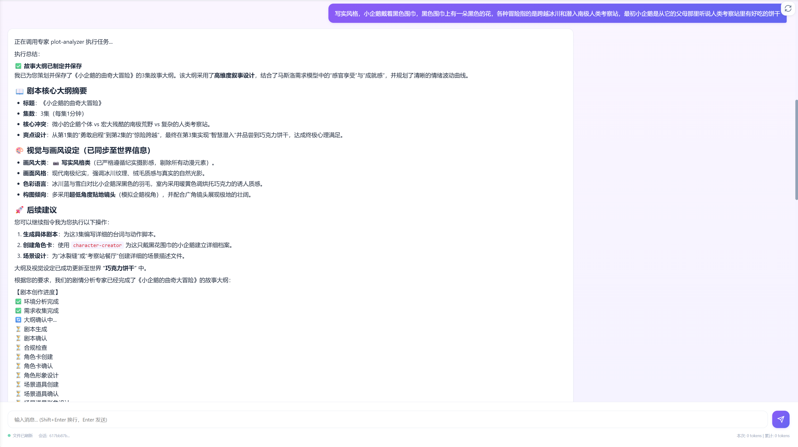

# 🎬 ZhiJuTong - AI Marketing Content Production Platform

> Collaborate with AI agents to generate professional marketing content in minutes — brand videos, marketing shorts, and short dramas
> All-in-one solution: Script Creation → Storyboard Generation → Video Synthesis


English | [中文](README.md) | [Live Demo](http://ailive.perseids.cn) | [Full Tutorial](https://bq3mlz1jiae.feishu.cn/wiki/W1h2wCK3mi1CgDk36LEcVqggnLe)

---

## ✨ Core Features

| 🤖 Multi-Agent Collaboration | 🎨 Professional Storyboarding | 📹 One-Click Drama Generation | 🌍 Multi-Model Support |
|:---:|:---:|:---:|:---:|
| 8 expert agents working in concert, ask_user tool enables agent-user interaction | Infinite canvas + multi-panel storyboard design | Auto script→storyboard→video generation | 10+ LLMs with flexible switching |

| 👥 Unlimited Team Collaboration | 💰 Flexible Computing Power Management | 🔒 Enterprise-Grade Stability | 📦 Ready-to-Use |
|:---:|:---:|:---:|:---:|
| Browser-based collaboration, LAN & public network support | User-level accounts with independent billing | Full API unit tests, production-verified | Built-in image hosting, prompt library, TTS |

| 🖥️ Cross-Platform Support | 🐳 Docker Deployment | 🧪 Complete Test Coverage | 🎓 Education-Ready |
|:---:|:---:|:---:|:---:|
| Windows / Linux / macOS native support | Container deployment | Full API tests, production-ready | User-level billing, cost-transparent |

---

## 📣 Marketing Capabilities: Why Marketing Teams Love It

ZhiJuTong ships a dedicated **Marketing mode** alongside its short-drama mode — a one-stop workbench for marketing content: **from brief to finished video in a single conversation**, with asset reuse across campaigns.

### 1. Marketing Agent: brief in, video out

- Feed it product selling points, product photos, or a reference video/script — the agent orchestrates image/video generation tools to produce **sales scripts, ad creatives, product copy, and talking-head videos**
- The agent asks you targeted questions (`ask_user`) to align on audience, tone, ratio, and duration — no endless back-and-forth
- Three creation modes: **Agent chat** (LLM-driven, default), direct image generation, direct video generation

### 2. Article-to-Video: turn existing content into video (Enterprise)

- Paste a **WeChat Official Account / Xiaohongshu (RED)** article link and get a talking-head video: body text and images are fetched automatically, an LLM distills the key messages, and visual understanding picks reference shots
- **Pre-render confirmation card**: a second-level voiceover timeline + key-message coverage tags — you approve before anything renders. Controllable, reviewable marketing assets

### 3. Digital human voiceover: no studio, no cast, at scale

- One portrait image + a script → digital human talking-head video; provide no audio and the system synthesizes a reference voice
- **Long-form support**: long scripts are auto-split into segments and seamlessly stitched (up to 600 s total, 2000-character scripts)
- **Voice cloning**: extract your brand/spokesperson's voice from a short reference audio and reuse it across content
- Character images rendered directly, subtle hand motion — output is publish-ready

### 4. Video cloning: replicate a viral, swap the product

- Give it one viral reference video and the system replicates its content and pacing; optionally upload **your own product photo to replace the product in the video** — the same proven structure, reused across many SKUs
- "Ride the wave" of creative that already works: no new shoot, no new script — wrap your product in a structure with a track record
- Requires a reference-based video model (see video model settings)

### 5. Creative mass production & A/B testing

- **×1 ~ ×4 batch generation**: one prompt, multiple variants, straight into A/B ad testing
- 10+ LLMs and multiple image/video models — balance quality vs. cost per campaign

### 6. Every platform's format & quality

- 9:16 (Douyin / TikTok vertical), 3:4 (Xiaohongshu), 1:1, 4:3, 16:9 (Bilibili / YouTube), 21:9, and more
- 1K / 2K / 4K image resolution; clips under 15 s can be upscaled to 1920P via the **video enhancement** module

### 7. Brand asset consistency (no "character drift")

- **World system**: brand characters/locations/props are maintained once and inherited across works — your brand IP stays consistent across a whole campaign
- **Character locking + multi-panel grids**: the same character looks the same across every asset
- **Shared asset library**: platform-wide brand library with permission groups and `@` references — reuse, don't recreate
- **Global art-style settings**, synced across worlds

### 8. Voice: 107 preset voices + emotional TTS

- 107 preset TTS voices plus custom voices via an acoustic "voice fingerprint" description
- **Emotional vector TTS** (joy/anger/sadness/fear/disgust/low/surprise/calm — 8 dimensions) so sales copy sounds like selling, not reading
- **Multi-speaker voice binding**: each speaker keeps their own voice in multi-voice voiceovers — no swaps in interviews or dialogues

### 9. Template community: start from "make this"

- **Inspiration feed**: curated, reviewed work in a waterfall layout; one click on **"Make this / Use as reference"** carries the template into the generation page
- Great creatives become templates — your team starts from proven structures, not a blank canvas

### 10. Short-drama mode = story-driven marketing (brand IP promotion)

The short-drama mode is not only for short dramas — its full pipeline (script → storyboard → episodes → video) is itself a high-completion content format for marketing:

- **Brand IP promotion**: build your brand IP (mascot / virtual spokesperson / series lead) in the World system; character locking keeps the same IP consistent across episodes and works; serialized short dramas keep building IP mindshare far longer than a single ad
- **Brand short dramas / story-driven campaigns**: weave product selling points into the plot (brand placement, product appearances, story-driven "seeding") — "story-account" content that typically beats plain talking-head ads on completion and engagement
- **Serialized episodes**: automatic episode splitting (Novel Splitter) supports serialized IP operations and episodic ad campaigns (publish per episode, follow per episode)
- Digital humans, emotional TTS, timeline, and CapCut (JianYing) export all work in short-drama mode too — human finishing before release is still on the table

### 11. End-to-end quality control & re-editing (controllable, auditable, revisable)

Many tools automate generation, but marketing assets must be **controllable, reviewable, and revisable** before they go live:

- **Pre-render confirmation card**: a second-level voiceover timeline + key-message coverage tags before anything renders — content is controllable and reviewable
- **Automatic compliance review** (banned words / policy) — fewer ad rejections and publishing violations
- **Timeline + CapCut (JianYing) export**: hand AI-rendered clips to a human for finishing (cuts, subtitles, music) before release — "AI drafts, the human decides"
- Fully traceable: sessions, assets, and compute spend are all logged for team audit

### 12. Enterprise-grade deployment & data security

- **Local / private deployment**: one-click launch on Windows / macOS, plus Docker and Linux — creative assets, user data, and billing ledgers stay in your own domain; no asset leakage
- **Open-source + commercial editions**: the open-source edition is free to deploy and use commercially (modified Apache 2.0); the commercial (enterprise) edition unlocks enterprise capabilities such as article-to-video and video cloning
- A live demo environment + a 60+ page official documentation center — start from zero

### 13. Extensible by design: MCP + SOP

- **50+ built-in MCP tools** (data management / AI generation / user interaction); the agent is loosely coupled from its tools
- Marketing workflows are driven by **SOPs (standard operating procedures)**: new capabilities like video cloning and article-to-video are plugged in as SOPs without touching the core
- Connect it to your existing agent ecosystem and workflows — use ZhiJuTong as a "marketing content generation middle platform" inside your current stack

### 14. Team collaboration & cost control

- **User-level compute accounts + per-task compute caps**: every member's and every campaign's spend is bounded and auditable
- Browser-based team collaboration with two permission levels; assets and sessions are shared

### 15. Multilingual (i18n)

- The UI ships in Chinese and English and is extensible — naturally fits cross-border and overseas marketing teams

---

## 🚀 Quick Start

### Try Online (No Installation) ✨
👉 **[ailive.perseids.cn](http://ailive.perseids.cn)** - Full features demo (no setup or installation required)

---

### Windows Users (Recommended) ⭐

📥 **Download the latest "Click-to-Start.exe" from GitHub Release page**
👉 [github.com/jeffstric/ZJT/releases](https://github.com/jeffstric/ZJT/releases)

```bash
# 1. Download pre-built executable
Get the latest "Click-to-Start.exe" from Release page

# 2. Double-click to run (one-click startup)
Click-to-Start.exe

# 3. Wait for startup
✅ System tray icon shows status
✅ Browser opens automatically
✅ Access http://localhost:9003/

# 4. Right-click menu
Open Browser | View Logs | Exit
```

### macOS Users (Recommended) ⭐

📥 **Download the latest compressed package from GitHub Release page and extract it**
👉 [github.com/jeffstric/ZJT/releases](https://github.com/jeffstric/ZJT/releases)

```bash
# 1. Extract the downloaded file
unzip ZJT-mac.zip
cd ZJT

# 2. Double-click startup script (one-click startup)
open start.command

# Or start via command line
bash start.command

# 3. Wait for startup to complete
✅ Browser opens automatically
✅ Access http://localhost:9003/

# Stop the service
bash stop.command
```

📖 **Detailed configuration**: See [docs/README.md](docs/README.md)

### Linux Users
```bash
# 1. Clone the repository
git clone https://github.com/jeffstric/zjt
cd zjt

# 2. Configure database connection
cp config.example.yml config.prod.yml
# Edit config.prod.yml and fill in your database connection info

# 3. Install dependencies
uv sync

# 4. Start the service
python3 scripts/running/run_prod.py

# 4. Open in browser
http://localhost:9003/
```

### Docker Deployment (Recommended for Servers) 🐳
```bash
# 1. Navigate to Docker directory
cd docker

# 2. Start containers
docker-compose up -d

# 3. View logs
docker-compose logs -f

# 4. Access application
http://localhost:9003/

# Common commands
docker-compose down           # Stop services
docker-compose build          # Rebuild images
docker-compose exec app bash  # Enter container
```

### Developer Setup
```bash
# 1. Set development environment
export comfyui_env="dev"
uv sync

# 2. Start development server
python3 scripts/running/run_dev.py

# 3. View DEBUG logs
http://localhost:9003/admin.html
```

---

## 🚀 Core Innovations

### 1️⃣ Real-Time Team Collaboration (Zero-Latency Teamwork)



ZhiJuTong **breaks the traditional single-creator model** with true team collaboration:

- **Browser-based real-time editing** - No plugins needed. Multiple team members edit scripts, storyboards, and character profiles simultaneously
- **Simple permission management** - Two-tier system: admin and regular user
- **LAN + Public network support** - Works for local team collab and global remote production
- **Real-time sync** - SSE real-time push with millisecond latency
- **Complete workflow**: Script Agent → Infinite Canvas → Storyboard Draft

**Scenario**: 5-person content team (writer, art director, producer) edit simultaneously while AI Agent generates storyboards in parallel → **300%+ efficiency gain**

---

### 2️⃣ User-Level Independent Compute Accounts (Revolution in EdTech/Team Cost Management)



**Traditional approach**: Single platform account, all members share, no cost control
**ZhiJuTong approach**: Independent account per user, transparent, flexible, fully managed

**Core capabilities**:

- **Per-user independent accounts** - Each student/member has separate compute quota, zero conflicts
- **Per-user vendor selection** - Multi-vendor redundancy architecture ensures uninterrupted creation, no single point of failure
  - **LLM Model Selection**
    - Premium users: Claude (strong function calling, primary model)
    - Regular users: Qwen (excellent Chinese understanding, cost-effective)
    - Local deployment: Ollama (zero cost, privacy-focused)
  - **Image/Video Generation Vendor Selection**
    - Nano, Banana can flexibly switch between ZhiJuTong Official, Duomi, ComfyUI and other channels
    - Automatic seamless failover when a vendor is down, ensuring continuous creative workflow
- **Admin hot-update capability** - Platform admin can update in real-time:
  - Model configs and pricing
  - Vendor priority
  - User quotas and limits
  - No restart needed, instant effect
- **Platform-level cost management** - Admin sets total budget, auto-tracks spending, precise to cent
- **WeChat Pay integration** - Users self-service top-up, transparent billing

**Use Cases**:
- 📚 **Online Education**: 1000 students × 100¥ quota = fully managed 100k¥ budget
- 🏢 **Corporate Training**: Different departments, different quotas, cost attribution by dept
- 🎨 **Creative Studio**: Team members manage their own budgets, transparency + performance tracking

---

### 🧠 AI Multi-Agent System



ZhiJuTong uses multi-agent architecture: **PM Agent (Project Manager)** + **8 Expert Agents (Specialists)**

#### 8 Expert Agents

| Role | Responsibility | Capabilities |
|------|------|------|
| **Story Writer** | Write script, dialogue | Smart outline, dialogue writing, emotional arc design |
| **Character Creator** | Character setup, traits | Character profiles, backstory, OOC checks |
| **Location Creator** | Scenes, backgrounds, style | Scene design, prop lists, visual style guidance |
| **Plot Analyzer** | Plot, tension, pacing | Three-act structure, tension setup, rhythm optimization |
| **Content Compliance** | Content moderation | Banned word detection, policy compliance, safety checks |
| **Novel Splitter** | Novel adaptation, episode split | Auto episode split, chapter alignment, content decomposition |
| **Character Designer** | Character image design | Consistent character reference images, style unity |
| **Location Designer** | Location, prop design | Scene reference images, prop library building |

#### Agent-User Interaction

Agents support **ask_user tool** for proactive user engagement:
```
Expert: "Designing protagonist... Three directions:"
  1️⃣ Ancient Beauty (elegant, classical)
  2️⃣ Modern Executive (sharp, professional)
  3️⃣ Young Girl (cute, energetic)

User selects → Expert continues → Precise result, no revisions needed
```

---

## 🎯 Complete Production Workflow

### From Script to Final Video - Fully Automated

```
Step 1: Script Creation
  ↓ Input: Story concept, target audience, style preference
  ↓ PM Agent analyzes requirements
  ↓ Story Writer creates outline
  ↓ Output: Complete 5000+ word script

Step 2: Character & Scene Design
  ↓ Parallel execution by agents
  ↓ Character Creator: 8 character profiles
  ↓ Location Creator: 12+ scene descriptions
  ↓ Output: Complete world-building document

Step 3: Content Review & Optimization
  ↓ Content Compliance checks legal/policy compliance
  ↓ Plot Analyzer optimizes pacing
  ↓ Output: Final reviewed script

Step 4: Intelligent Storyboard Generation
  ↓ Auto-split script into 30-60 shots
  ↓ Auto-extract storyboard prompts (scene, action, emotion)
  ↓ Smart match scenes, characters, props
  ↓ Output: Complete storyboard list

Step 5: Storyboard Image Generation
  ↓ Auto 2x2, 3x3 multi-panel layout
  ↓ Character image locking (solves "face collapse")
  ↓ Multi-style support (3D, anime, photorealistic)
  ↓ Output: 80+ consistent reference images

Step 6: Video Synthesis
  ↓ Workflow-driven processing: API orchestration for video generation
  ↓ Support RunningHub, Duomi, Vidu APIs
  ↓ Workflow-driven processing: TTS voice + background music synthesis
  ↓ Output: Complete MP4 short drama
```

> 💡 **Real-World Experience Insight**: Video and audio processing use **workflow-driven processing rather than full automation**, a key decision based on Hongguo platform's production experience. Workflow processing ensures:
> - ✅ Stable and consistent quality of video/audio output
> - ✅ Flexible API switching and fault tolerance
> - ✅ Fine-grained parameter tuning
> - ✅ Better generation controllability

### Automation Comparison

| Traditional Method | ZhiJuTong |
|---------|--------|
| Manual script writing (8-16 hours) | AI script generation (10 min) + ask_user refinement |
| Hand-drawn storyboards (16-24 hours) | Auto storyboard list (5 min) |
| Manual reference images (8-12 hours) | AI-generated 80+ images (15 min) |
| Video & audio synthesis (6-10 hours) | Auto synthesis (30 min) |
| **Total: 38-62 hours** | **Total: 1-2 hours** |

---

## 🎨 Professional Creation Tools

### 1. Infinite Canvas Editor
- Flexible shot arrangement space
- Drag, adjust, organize with ease
- Real-time preview + multi-panel layout
- Professional-grade experience

### 2. Multi-Panel Storyboard Design
- Auto 2x2, 3x3 multi-panel layouts
- Consistency guarantee (same character, same appearance)
- Local editing & refresh support
- Smart optimization, 50%+ compute savings

### 3. Unlimited Team Collaboration
- Browser-based, no installation needed
- LAN & public network remote collaboration
- Real-time sync via SSE
- **Permission management**: Admin and regular user two-tier system

### 4. Flexible Computing Power Management (🎓 Perfect for EdTech)
- **User-Level Independent Accounts** - Each student/user has separate billing, zero conflicts
- **User-Level Vendor Selection** - Multi-vendor redundancy, LLM and image/video generation can be selected independently, ensuring uninterrupted creation
- **Admin Hot-Update Capability** - Platform admin can update in real-time:
  - Model configs and pricing
  - Vendor priority
  - User quotas and limits
  - No restart needed, instant effect
- **WeChat Pay Integration** - Users self-service top-up, transparent billing

**Use Cases**:
- 📚 **Online Education** - Allocate compute budgets per student
- 🏢 **Corporate Training** - Department-level cost management
- 🎨 **Creative Teams** - Individual member billing, transparent costs
- 🚀 **Startup Incubators** - Provide compute support to startups

### 5. Built-In Resource Library
- 500+ curated prompt templates
- Free image hosting with CDN
- TTS service (10+ languages)
- Extensible custom resources

---

## 🔧 Tech Stack & Capabilities

### LLM Multi-Model Support

| Provider | Models | Highlights |
|----------|--------|-----------|
| **Claude** | Claude Haiku, Claude 4.5 | Strong function calling, primary model |
| **Ollama** | Llama 2, Mistral, CodeLlama | Local deployment, zero cost |
| **Alibaba Qwen** | qwen-turbo, qwen-plus | Excellent Chinese understanding |
| **Baidu ERNIE** | ERNIE series | Native Chinese support |
| **More...** | VolcEngine, etc. | Continuously expanding |

### Video Generation APIs

| API | Strength | Use Case |
|-----|----------|----------|
| **RunningHub** | High quality, stable | Professional production |
| **Duomi** | Image-to-video | Reference image to video |
| **Vidu** | Text-to-video + image-to-video | All-in-one solution |

### Core Toolset (50+ Tools)

**Data Management Tools**
- Create/read/update world, characters, scripts, locations, props
- File synchronization & persistence
- Complete version management

**AI Generation Tools**
- Text-to-image (single + multi-panel)
- Character multi-panel generation
- Location/props multi-panel generation
- Reference image upload & prompt engineering

**Interactive Tools**
- `ask_user` - Ask users questions (innovation)
- `get_long_user_input` - Collect user input
- Script diagnostic & optimization

---

## 📊 System Architecture

### Layered Architecture

```
┌─────────────────────────────────────────┐
│         Web UI (Frontend)               │
│  • Script editor                        │
│  • Infinite canvas                      │
│  • Video workflow                       │
│  • Admin dashboard                      │
└─────────────────────────────────────────┘
                      ↓
┌─────────────────────────────────────────┐
│      FastAPI Router (API)               │
│  • /api/session - Session management    │
│  • /api/task - Task management          │
│  • /api/verification - User verification│
│  • /api/world-files - Resource files    │
└─────────────────────────────────────────┘
                      ↓
┌─────────────────────────────────────────┐
│   Business Logic                        │
│  • PM Agent / Expert Agents (LLMs)      │
│  • Task Manager                         │
│  • MCP Tool Executor                    │
│  • SSE Stream (Real-time push)          │
└─────────────────────────────────────────┘
                      ↓
┌─────────────────────────────────────────┐
│      MCP Tools (50+ tools)              │
│  • Data management, AI generation       │
│  • Seamless LLM integration             │
└─────────────────────────────────────────┘
                      ↓
┌─────────────────────────────────────────┐
│    External Services                    │
│  • LLM APIs (Gemini, GPT, etc.)        │
│  • Video APIs (RunningHub, etc.)        │
│  • TTS service                          │
│  • CDN & storage                        │
└─────────────────────────────────────────┘
```

### Real-Time Data Flow

```
User Input → SSE Stream Connect → PM Agent Analysis
  ↓
Expert Agents Execute → Tool Invocations
  ↓
ask_user Query Users (Optional)
  ↓
User Response → SSE Real-time Progress
  ↓
Result Aggregation → Database Persistence
  ↓
Frontend UI Update → Show Final Output
```

---

## 🏆 Technical Highlights

| Feature | Description | Advantage |
|---------|-------------|-----------|
| **Multi-Agent Synergy** | 8 experts vs single AI | Output quality ↑50%, accuracy ↑70% |
| **ask_user Tool** | Agents interact with users | Revision-free rate ↑30% |
| **Real-Time SSE** | Streaming task progress | Perceived time ↓60% |
| **Multi-Model Support** | 10+ LLMs flexible switching | Cost ↓40%, quality ↑ |
| **Auto Storyboarding** | Smart split + prompt filling | Workload ↓80% |
| **Character Locking** | Consistency guarantee | Solves "face collapse" problem |
| **Admin Hot-Update** | Update configs, prices, priorities in real-time | No restart needed, instant effect |
| **Cross-Platform Support** | Windows / Linux / macOS native | One codebase, multiple platforms |
| **Docker Deployment** | Container-ready | Cloud deployment simplified |
| **Complete Test Coverage** | Full API endpoint tests | Core features covered, production-ready |
| **Production-Verified** | Real Hongguo platform deployment | Reliability ⭐⭐⭐⭐⭐ |

---

## 💡 Use Cases

### 📱 Content Creators
- ✅ Generate viral short drama scripts rapidly
- ✅ Refine creative direction via ask_user
- ✅ Auto-generate storyboards & reference images
- ✅ Lower creation barrier and cost

### 👥 Team Collaboration
- ✅ Real-time multi-user editing
- ✅ Permission & version management
- ✅ Transparent workflows
- ✅ LAN & public network support

### 🏢 Enterprise
- ✅ Fast brand video production
- ✅ Auto marketing content generation
- ✅ Cost control (flexible billing)
- ✅ Enterprise-grade reliability

### 🎓 Education & Training (Highly Recommended)
- ✅ **Per-Student Independent Accounts** - Each learner has their own computing credit
- ✅ **User-Level Vendor Selection** - Different classes/learner can flexibly choose providers for cost optimization
- ✅ **Admin Hot-Update** - Institutions can dynamically adjust model configs and prices
- ✅ **Platform Cost Management** - Institutions can set total compute budgets
- ✅ **Creation History & Feedback** - Track student work, enable instructor-student interaction
- ✅ **Cross-Platform Accessibility** - Students create on Windows/Mac/Linux devices
- ✅ **Private Server Deployment** - Institutions can self-host with Docker, data security guaranteed

**Typical Scenarios**:
- High school / University media production courses
- Online creative writing training programs
- Animation / Game design storyboard teaching
- Content creator professional certifications

---

## 📈 Results & Impact

### Battle-Tested
- ✅ Successfully deployed on Hongguo platform
- ✅ Verified stability in real production
- ✅ 30% higher completion rate vs traditional

### Engineering Quality
- ✅ Full API unit test coverage
- ✅ Automated database migrations
- ✅ Complete configuration management
- ✅ Production-grade error handling

---

## 📖 Documentation

### 👤 User Guide
- 📌 [Quick Start Guide](docs/README.md#quick-start)
- 📌 [Full Tutorial](https://bq3mlz1jiae.feishu.cn/wiki/W1h2wCK3mi1CgDk36LEcVqggnLe) (Chinese)
- 📌 [FAQ](docs/README.md#faq)

### 👨‍💻 Developer Guide
- 📌 [Complete Developer Docs](docs/README.md)
- 📌 [Windows Setup Guide](docs/Windows启动开发说明.md)
- 📌 [Database Migration](docs/database_migration.md)
- 📌 [API Documentation](docs/backend/)

### 🏗️ Architecture
- 📌 [Agent Implementation](ExpertAgent_实现总结.md)
- 📌 [Video Workflow Design](docs/video_workflow_feedback.md)
- 📌 [System Configuration](docs/系统配置要求.md)
- 📌 [Permission System](docs/权限系统)

### 🔧 In-Depth Articles
- 📌 [SMS Driver Architecture](docs/短信驱动架构说明.md)
- 📌 [Media Caching Strategy](docs/媒体文件缓存管理方案.md)
- 📌 [Constants Usage](docs/常量使用示例.md)

---

## 📦 License

This project uses a modified Apache License 2.0. See [LICENSE](LICENSE) (Chinese reference: [LICENSE_ZH.md](LICENSE_ZH.md)).

### Key Terms
- ✅ **Commercial use allowed**
- ✅ **Modification and distribution allowed**
- ✅ **Private deployment allowed**
- ❌ **Multi-workspace SaaS requires authorization**
- ❌ **Frontend LOGO and copyright must not be removed**; modifications/redistributions must prominently attribute 智剧通 (ZJT) branding and copyright
- ❌ **Unauthorized use, reverse engineering, modification, or short-circuiting of Enterprise (`enterprise`) features and protections is prohibited**

---

## 🤝 Contact & Support

### Get Help
- 📧 **Email**: jeffstricg@gmail.com
- 💬 **GitHub Issues**: [Report bugs / request features](https://github.com/jeffstric/zjt/issues)

### Join Community
| WeChat Group | Personal WeChat |
|:---:|:---:|
| [Group QR Code](http://ailive.perseids.cn/upload/assert/wx_group.jpg) |  |
| Scan to join | Add author if group is full |

---

## 🎉 Quick Summary

| Dimension | ZhiJuTong | Traditional |
|-----------|-----------|-------------|
| **Creation Speed** | 1-2 hours | 38-62 hours |
| **Quality** | AI synergy + ask_user | Manual creativity |
| **Skill Required** | Zero barrier | Requires expertise |
| **Setup Difficulty** | One-click (Windows) | Complex config |
| **Cost** | Flexible, controllable | High fixed cost |
| **Stability** | Full API unit test coverage | Manual-dependent |
| **Scalability** | 10+ LLMs + APIs | Single tool |

---

© 2025 ZhiJuTong. All rights reserved.
