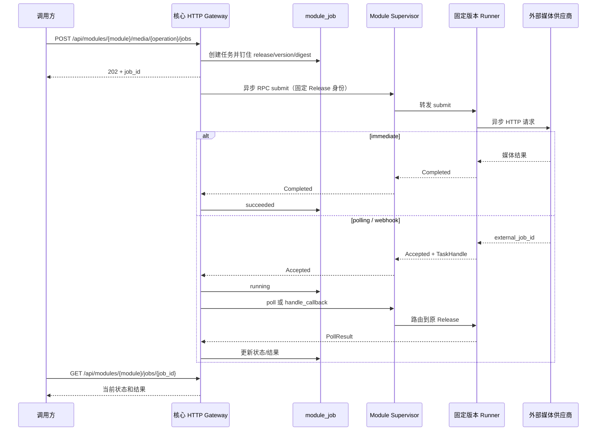

> **代码位置（develop_f1214 起，自 enterprise 包迁入主仓并解除许可证门禁）**：
> 运行时 `module_runtime/`、路由 `api/user_module{s,_admin}.py`、
> 服务 `services/user_module_*.py`、模型 `model/user_modules{,_binding}.py`、
> 生成智能体工具 `tools/user_module_agent_tools.py`、调度注册
> `task/user_module_scheduler.py`、Supervisor 启动器
> `task/module_supervisor_launcher.py`、引导分流 `services/user_module_bootstrap.py`。
> 主仓接缝：`USER_MODULE_*` 契约常量、`config/user_module_abi.json`、
> alembic 迁移与前端管理界面。
> Runner 子进程经 PYTHONPATH 以裸名 `module_runtime.*` 解析协议，已发布模块无需改动。
> **协议类单份约束**：Runner 进程内运行时必须与用户模块共享同一份协议类
> （pydantic 对实例做类身份判定，双模块键会让协议 union 整体拒绝——曾导致
> MODULE_CALL_FAILED 真实事故）。runner.py 在 Runner 进程内只走裸名导入；
> Runner 校验一律先 `model_dump` 按结构校验（`_validate_result`）作纵深防御，
> 协议违规返回 `MODULE_PROTOCOL_VIOLATION` 结构化错误码。
> **新旧并存分流**：存量 enterprise 包自带旧版实现（带商业许可证门禁）时，
> 所有挂载点经 `services/user_module_bootstrap.enterprise_provides_user_modules()`
> 判定（edition.mode=enterprise 且旧版 `enterprise.register` 仍含
> `_register_user_modules`）优先走 enterprise 版，主仓版让位——避免双份路由/
> 调度/Supervisor/生成工具。开源部署（community 模式）恒走主仓版。
> enterprise 仓移除用户模块并抬升 min_core_version 后，分流恒走主仓版，
> 兼容层可整体删除。

# 用户模块运行时

## 目标

用户生成代码与核心代码使用不同的存储和执行边界。核心代码可以通过自动更新执行
`git reset --hard`，用户模块 release 不得被覆盖，也不得被 FastAPI Worker 或 scheduler
直接导入。

## 模块根目录

解析优先级如下：

1. 环境变量 `ZJT_USER_MODULES_DIR`。
2. YAML 配置 `user_modules.root`。
3. 默认目录 `<project>/data/user_modules`。

生产部署推荐使用仓库外绝对路径。Docker 使用默认路径时，现有 `/app/data` volume 会持久化模块。
升级器会在 `reset --hard` 前完成两类检查：仓库内模块目录不能被当前 Git 或目标版本跟踪；
目标版本必须提供 `config/user_module_abi.json`，且每个已安装 Release 的 Manifest 都要与目标 ABI
兼容。默认 `upgrade.user_module_compatibility_policy=block`，发现目录冲突、缺少目标 ABI 或版本/协议
不兼容时保留当前核心，不执行更新。可选 `quarantine` 会写入
`state/update-compatibility.json` 作为升级审计记录后继续升级。新 Supervisor 不以该报告作为执行依据，
而是在每次启动 Release 前按当前本地 ABI 重新校验并隔离不兼容实现，因此报告不能绕过运行时闸门。

目录结构：

```text
user_modules/
  staging/<generation_id>/
    .generation-state.json
    manifest.json
    src/__init__.py
    src/driver.py
    tests/
    README.md
  modules/<module_id>/releases/<internal_release>-<digest>/
  state/agent-tasks/<task_id>.json
  envs/
  runtime/
```

release 发布后不可原地修改。运行状态、临时文件和环境必须存放在 release 目录之外。

智剧通核心版本只从根目录 `pyproject.toml` 读取。`config/user_module_abi.json` 描述协议能力，运行时
会用 `pyproject.toml` 的值覆盖其中的版本快照。草稿校验时，服务端按当前核心版本自动写入内部
Release 标识和 `core_compat`；管理员无需在页面中填写模块版本。内部 Release 仍然必须存在，
因为同一个智剧通版本内可能多次修改代码，并且旧异步任务需要继续钉住原代码摘要。

## Manifest v1

`manifest.json` 记录模块身份、不可变摘要、入口、协议、能力、权限和资源限制。当前稳定边界为：

```text
manifest schema: 1
RPC protocol: user-module-rpc/v1
driver protocol: media-driver/v1
SDK version: 1.0.0
```

模块标识使用带命名空间的稳定字符串，例如 `vendor.image-service`。动态模块不得占用核心的数字
`implementation` ID。

模块可声明图片、视频、音频操作，以及 `immediate`、`polling`、`webhook` 完成模式。
完成模式与代码执行模型分离；核心 Web 接口和 RPC 始终是非阻塞调用。
MVP 只接受 `native_async` 代码执行模型；Manifest 声明的单次请求大小、操作 deadline 和最大并发
会由核心与 Runner 双重执行。Release 摘要覆盖源码以及去除 `code_digest` 后的规范化 Manifest，
因此入口、权限、能力或资源限制被修改都会使完整性检查失败。

## 安全边界

- 核心进程只读取 Manifest，不导入用户实现。
- 路径解析拒绝 `..`、软链接和 Windows reparse point 越界。
- 自动生成校验拒绝直接文件访问、动态代码执行、核心包导入和已知阻塞调用；这些是审批闸门，
  不是对恶意代码的强沙箱保证。
- RPC 载荷和 Manifest 有大小上限。
- `MediaRef` 只传递资产 ID 或短期 URL，不传任意宿主机路径和大块 Base64。
- 独立进程是故障隔离，不是多租户安全沙箱；第一版只允许可信管理员启用代码。
- Manifest 的 `secret_names` 仅允许平台可授权密钥清单内的名称。Supervisor 在**每次** RPC（submit /
  poll / health / cancel / handle_callback）时按白名单重新解析密钥，写入当次
  `DriverContext.secrets`；模块只能从 `ctx.secrets` 读取。Runner 进程环境不注入业务密钥，
  也不继承数据库账号、核心配置或 Supervisor 令牌。后台更新 `huimengi.api_key` 等动态配置后
  立即生效，无需重启 Runner。同名 OS 环境变量（Supervisor 进程）优先于动态配置。
- **密钥授权（审批即授权）**：`config/default_configs.py` 中标记 `user_module_grantable=True`
  的动态配置（admin 快速配置弹窗中的供应商密钥/token，如 `runninghub.api_key`、
  `huimengi.api_key`、`duomi.token`、`vidu.token`、`api_aggregator.site_*.api_key`、
  `llm.*.api_key` 等）会
  自动生成「密钥规范名 → 配置键」映射（规范名 = config_key 大写并把 `.` 换成 `_`，如
  `RUNNINGHUB_API_KEY`）；静态校验强制 `secret_names` 只能取这些规范名，生成任务的描述也会
  附带该清单。发布审批弹窗显式展示「该模块将获得的密钥」（名称/描述/是否已配置，不含值），
  管理员批准发布即完成授权，审计即发布记录。`GET /api/admin/user-modules/secret-catalog`
  返回同一目录。撤销授权 = 去掉标记发版或禁用模块（无按模块粒度的授权记录）。未标记的配置
  （`zjt.token`、支付/存储等核心机密）模块永不可达；密钥值不会写入
  Release、数据库任务、日志或管理接口响应。Runner 不得读取 `system_config` 或任意环境变量。
  历史说明：旧的手写别名表 `USER_MODULE_SECRET_CONFIG_ALIASES`（`HUIMENG_API_KEY` 等）已
  删除；存量模块中声明 `HUIMENGI_API_KEY` 的因推导规则天然继续可用，声明旧拼写
  `HUIMENG_API_KEY` 的需重新生成。
- `network_hosts` 是生成审查和后续出站代理使用的声明字段；MVP 尚未提供内核/容器级网络隔离，
  不能把它当作强制防火墙。因此仍只允许可信管理员审批代码。本地 ComfyUI 模块会声明局域网
  `host:port`；后续若强制白名单，已声明的私网地址应放行，未声明的内网仍拒绝。
- 模块还可 `from module_runtime.comfyui import ...`。该子模块不得依赖 `os`/`subprocess`/
  `config`/`model`。

## 后续运行链路

固定 HTTP Gateway 通过异步 RPC 调用唯一 Module Supervisor，Supervisor 再把请求路由到任务钉住的
module-version Runner。模块崩溃、超时或不兼容时只隔离对应模块，核心服务继续启动和提供其他接口。



## 数据表与版本钉住

- `user_module`：模块开关、当前激活 Release 和隔离状态。
- `user_module_release`：不可变版本、摘要、Manifest、协议和兼容状态。
- `module_job`：一次媒体请求及其状态。

任务时间字段统一按 UTC 写入无时区 `DATETIME`，到期查询使用 `UTC_TIMESTAMP()`，避免宿主时区变化
导致任务被提前超时。任务创建时复制 `release_id`、`module_version`、`code_digest` 和
`protocol_version`。激活新版本只影响
新任务；旧任务的轮询、回调和结果解析继续路由到原 Release。只要某个 Release 仍有非终态任务，
就不能物理删除该 Release。

## 进程与 RPC

`scripts/running/run_prod.py` 在数据库迁移完成后生成本次启动专用的随机令牌和本机端口，并显式
启动唯一 Supervisor。scheduler 与全部 Web Worker 只继承 Supervisor URL/令牌，不启动 Runner。

Supervisor 按 `module_id + version + code_digest` 管理 Runner。每个 Runner 绑定随机本机端口，使用
独立随机令牌，只导入一个不可变 Release。Runner 环境变量使用白名单构造，不继承数据库账号、
核心服务密钥或业务 API Key；业务密钥由 Supervisor 在每次 RPC 时从动态配置解析后写入当次
context。Supervisor 重启时同时加载当前激活 Release 和仍被非终态任务引用的旧 Release。

RPC 请求具有固定大小限制、连接超时、调用 deadline 和身份三元组校验。Runner 调用超时后，
Supervisor 会终止该 Runner；用户模块不能让 FastAPI Worker 的事件循环同步等待。

## 固定 HTTP 网关

调用方只访问以下核心路由：

```text
GET    /api/modules/<module_id>/manifest
POST   /api/modules/<module_id>/media/<operation>/jobs
GET    /api/modules/<module_id>/jobs/<job_id>
DELETE /api/modules/<module_id>/jobs/<job_id>
POST   /api/modules/callbacks/<callback_token>
```

POST 默认创建持久化任务并返回 `202`。可使用 `Prefer: wait=N` 进行有上限的异步等待；超出等待
时间仍返回 `202`，不会阻塞事件循环。请求通过登录、幂等和 Manifest capability 校验后才会提交。
scheduler 每 3 秒接管尚未提交的任务、到期轮询任务和超过总 deadline 的任务。
Supervisor/RPC 的可重试故障会让提交回到队列、轮询延后重试；业务拒绝、契约错误或总 deadline
到期才进入终态，避免一次基础设施抖动永久丢失任务。

`immediate` 供应商由 submit 直接返回结果；`polling` 供应商返回 `TaskHandle` 并由 scheduler 轮询；
`webhook` 供应商收到 `parameters.callback.url`。回调 URL 使用按任务确定性签名的随机令牌，数据库
只保存令牌 SHA-256；即使 Web 进程重启仍能重建相同 URL。回调通过任务钉住的 Release 调用
`handle_callback`，不会路由到当前新版本。公网部署的纯 webhook 模块必须设置 `user_modules.callback_base_url` 或
`ZJT_USER_MODULE_CALLBACK_BASE_URL`；同时声明 `webhook` 与 `polling` 的模块在回调地址未配置时自动降级为
纯轮询（本地/内网部署收不到公网回调也能正常完成），配置了回调地址则优先回调、轮询兜底。

现有 `task/visual_drivers`、`task/async_drivers` 和 `ai_audio` 暂时保留原调用链，不会被自动转换。
新增的用户模块统一走 `/api/modules` 网关；此外，已激活模块可按下节方式绑定为核心任务条目的
动态实现方，直接进入业务模型选择与任务调度链路。后续迁移旧驱动时也应实现同一
`media-driver/v1` 契约，不能让动态模块重新占用核心数字 `implementation` ID。

## 接入核心模型链路（实现方绑定）

已激活模块的一个 capability 可以绑定到某个核心任务条目（`UnifiedTaskConfig`），成为该条目的
一个可选实现方（类似 seedance 同时提供汇梦/多蜜/火山渠道）。绑定后模型下拉、用户偏好、
算力管理复用既有实现方机制，业务前端无需改动。

### 操作步骤

1. 后台“接口模块”页面审批 Release 并激活模块；
2. 打开模块详情弹窗的“模型接入”区块。每种 capability 单独一行，文生图（`text_to_image`）
   和图片编辑/图生图（`image_edit`）可以同时绑定，互不影响。为某一能力选择匹配分类的
   模型条目后点“新增绑定”（`POST /api/admin/user-modules/<module_id>/bindings`，body 为
   `{module_id, task_id, operation}`）；支持的能力为 `text_to_video`、`image_to_video`、
   `text_to_image`、`image_edit`，任务条目分类必须与能力对应分类一致。同一模型条目若
   同时声明了文生图和图片编辑分类（如 Seedream 5.0 Pro），可以对两种能力各绑一次。
   绑定后该渠道出现在对应模型的实现方分组和用户渠道列表中；
3. 绑定创建后在 web 进程即时生效；scheduler 等其他进程由定时任务周期重载
   （`USER_MODULE_BINDING_RELOAD_INTERVAL_SECONDS`，默认 60 秒）；
4. 解绑（`DELETE /api/admin/user-modules/bindings/<binding_id>`）后实现方从候选列表消失；
   解绑不影响已在 `module_job` 中推进的作业，但引用该实现方的 `ai_tools` 任务将无法再刷新
   状态，建议等待相关任务完成后再解绑。

绑定到 `computing_power=0` 的任务条目时，动态实现方默认算力为 1（`USER_MODULE_DEFAULT_COMPUTING_POWER`），避免提交时扣费接口返回「算力值必须大于 0」。管理员可在实现方管理页覆盖。

绑定数据存于 `user_module_task_binding` 表（alembic 迁移 `20260820_module_binding`）。
实现方数字 ID 从 `USER_MODULE_IMPL_ID_BASE`（9000）预留区间顺序分配且不回收，与核心
数字 `implementation` ID 不冲突；实现方名形如 `user_module:<module_id>:<operation>`。

### 运行机制

- 提交：任务调度器通过 `VideoDriverFactory.create_driver_by_implementation` 实例化
  `task/user_module_driver.py` 的 `UserModuleMediaDriver`（绑定参数经
  `ImplementationConfig.driver_params` 注入）。驱动的 `submit_task` 把 `ai_tools` 字段映射为
  `MediaRequest`（引用图进入 `inputs`；本地/局域网 URL 先由核心统一上传 CDN 图床转为公网
  地址，再按图片模式以通用参数名冗余写入 `parameters` 供只读参数的模块使用；
  `ratio`/`duration`/`image_size`/`extra_config` 进入 `parameters` 原样透传），创建 `module_job`
  并立即分发；幂等键固定为 `aitool-<ai_tool.id>`，调度层重试不会重复提交。`project_id` 存储
  `module_job.job_id`。CDN 公网化对 first/last/reference/direct 四类槽位统一回填，且
  `extra_config` 中重复携带的已知媒体 URL 按同一映射替换——历史上只回填前三类，
  `parameters.image_url` 残留局域网地址被模块透传给外部供应商，导致 RunningHub 拉图失败
  （aitool-1129 事故，见生成合同「图片输入与图床：平台默认图床优先，供应商图床仅兜底」）。
  该公网化即模块生成智能体所称的「系统默认图床」：生成合同约定，供应商是 RunningHub
  或需求文档已详细说明其图片上传方式时继续用供应商图床；其余情况默认直接透传
  公网化后的 URL，禁止再问或自行实现供应商上传接口。
- 轮询：驱动 `check_status` 只读 `module_job` 表翻译状态，不发 RPC；作业的实际轮询/回调
  推进仍由 scheduler 的 `process_user_module_jobs`（每 3 秒）与 webhook 回调完成，两条
  调度链路解耦互不阻塞。成功结果取 `outputs` 中第一个 http URL 落入 `ai_tools.result_url`。
- 生命周期：绑定仅在模块 `enabled=1` 且 `status='active'` 时生效（查询 JOIN 过滤）；模块
  禁用/隔离后，下一次重载即从候选列表消失。模块升级 Release 不影响绑定，新任务自动使用
  新版本，旧任务按版本钉住继续推进。
- 算力与管理：动态实现方默认沿用挂载条目的算力声明，管理员可在后台“实现方管理”页按
  `implementation_power` 覆盖算力、排序或禁用；被禁用的实现方无法被用户偏好绕过。
  分组按挂载任务条目的 `driver_name` 与核心实现方同一张表（例如绑到 Seedream 5.0 Pro
  就进「Seedream 文生图」），`driver_key` 与用户模型选择一致。显示名带 operation 后缀
  （文生图 / 图片编辑），双分类条目不另开「用户模块 ·」分组。选哪个模型条目，用户就在
  那个模型的渠道列表里看到它。
  密钥由 Supervisor 在每次 RPC 时按 Manifest `secret_names` 白名单（`user_module_grantable`
  自动映射）从动态配置解析；核心 HTTP 进程与任务表不保存密钥值。后台改密钥后无需重启 Runner。
  生成任务注入的可授权清单会附带各配置的后台描述；`api_aggregator.site_N` 这类编号/共用
  槽位与供应商的实际对应关系只有管理员知道，生成智能体必须 `ask_user` 确认密钥槽位，
  禁止按编号顺序或描述相似度猜测（真实风险：toapi.gptimage_3 把 ToAPIs 密钥静默选成
  site_0，而 site_0 是预留槽位）。

### 已知约束

- 挂载条目的 `supported_durations`/`supported_ratios` 等声明以核心配置为准，绑定时不做
  能力交集校验；不匹配的参数会透传给模块，由模块自行忽略或报错。管理员绑定时应自行
  判断能力匹配。
- 跨进程感知新绑定最长延迟 60 秒（web 进程即时）；模块禁用同样受此延迟影响。


## 大模型生成与审批

项目 Skill 位于 `agents/skills/generate-user-api-module`，并注册了管理员专用专家
`generate-user-api-module`（`expert_type` 为 `admin`）。后台“接口模块”页面通过专用任务接口直接运行这个专家，不经过剧本
PM、世界或会话路由；剧本 PM（`agents_config.json` 的 `pm_agent.allowed_expert_types`）只包含 `script` 类型，
不包含 `admin`——即使配置被误改回包含 `admin`，`PMAgent` 运行时仍会按用户角色（`role == "admin"`）过滤，
非管理员用户无法看到或调用 admin 类专家。前端不能指定其他 Agent。执行在线程内进行，任务状态使用原子 JSON 放在
`state/agent-tasks`，FastAPI 请求只负责创建和短轮询，不阻塞事件循环。管理员令牌仅在线程参数中
短暂传递，不写入任务文件。跨 Worker 的文件锁统一执行全局生成并发上限；智能体只有在草稿状态为
`validated` 且校验结果为 `ok` 时才会标记任务完成。任务文件同时保存不含密钥的递增阶段事件
（含智能体 `tool_call` 进度），管理页通过 `after_id` 只拉取新事件并在加宽的进度弹框中滚动展示；
它不是依赖无鉴权 SSE 的装饰性进度。生成专家 `max_iterations` 为 80。创建任务时默认推荐
DeepSeek 官方供应商的 `deepseek-v4-flash`（`USER_MODULE_GENERATION_PREFERRED_MODEL`），
管理员仍可改选其它已启用模型。

### 交互式问答

模块生成是后台线程任务，没有剧本会话弹框。`ask_user` 通过 `BackgroundAskUserAdapter`
写入同一份 agent-tasks JSON：

- `question` 事件：选项、`allow_free_text`、`deadline_at`。结果只追加新事件，不改旧 question。
- 管理员 `POST /api/admin/user-modules/agent/tasks/<task_id>/answers`，body 为
  `{question_id, selected?, free_text?}`，至少一项；`free_text` 上限 20000。
- 仅任务创建人可答。心跳过期返回 `agent_task_interrupted`（任务已中断，请重新发起）；
  重复作答返回 `question_already_answered`。
- HTTP 供应商与本地 ComfyUI（`connector=local_comfyui`）每任务统一最多 15 问。
  单问等待 1800 秒。超时追加 `question_timeout`，智能体按现有 timeout 分支把未决问题写入结束总结。
- 等待期间任务状态保持 `running`，管理页根据 pending question 显示「等待管理员回答」。
- 提问等待会暂停墙钟预算（墙钟仍只约束 LLM 工作时间），但占用全局生成并发槽。
  关闭进度窗口后短轮询继续；出现 pending 问题时会再打开窗口。

### 停止生成

进度弹窗提供「停止生成」按钮，调用 `POST /api/admin/user-modules/agent/tasks/<task_id>/cancel`。
取消为**协作式**：接口立即把任务 JSON 置为 `cancelled` 终态（`error_code=agent_task_cancelled`，
幂等，仅任务创建人可取消），不硬杀执行线程；执行线程在下一个迭代检查点
（`ExpertAgent._run_task_loop` 开头，经 `BackgroundAskUserAdapter.check_cancelled` 感知）或
提问等待轮询中检测到终态后退出，正在进行的 LLM 调用会做完再停。终态保护保证线程退出时的
completed/failed 更新不会覆盖 `cancelled`，心跳与进度事件随之停止，执行槽在线程退出时释放。
任务终态集合为 `completed / failed / cancelled`；已产生的草稿仍保留在草稿列表，可重新发起生成。

提问内容由 `generate-user-api-module` Skill 约束：先把供应商文档里的接口映射到平台
operation（图生图即 `image_edit`，与文生图的 `text_to_image` 成对，不是额外能力），
只问文档中另有、需求尚未覆盖的接口；禁止把已覆盖的图生图再问成「是否接入 image_edit」，
也禁止臆造文档没有的 upscale/视频等选项。异步接口一律 `completion_modes: ["polling"]`，
即使供应商文档提供 `webhook_url` 也不实现回调、不向管理员询问 payload 格式；仅 submit
同步返回最终媒体时用 `immediate`。

### 本地 ComfyUI

后台新建接口模块可选「本地 ComfyUI」。管理员必须提供：

1. 该模块自己的 ComfyUI 地址（表单默认 `http://localhost:8188/`，即 ComfyUI 默认端口），写入 `vendor/comfyui.json`，生成代码抄进 `src/settings.py` 的 `COMFYUI_BASE_URL`。不使用密钥、不写全局热配置。多台设备 = 多个模块各写各的地址。
2. ComfyUI Save (API Format) 的工作流 JSON（管理页上传文件，核心写入 `vendor/workflow.json`）。运行时转为 Python 字面量，模块不得 `open()`。

运行时允许 `from module_runtime.comfyui import ...`（仅 HTTP 助手，无 `os`/`subprocess`）。协议仍是 `submit` + `poll`（`/prompt` 然后 `/history`）。局域网 `/view` URL 在模块作业 SUCCEEDED 之前由核心上传 CDN，避免把 `192.168...` 暴露给浏览器。

绑定仍走「模型接入」：例如把生成的 `image_edit` 能力绑到空壳任务 `qwen-image-edit`（task_id=38）。

大模型只拥有以下受限能力：

1. 创建 generation；
2. 检索和读取 `module_runtime/`、本文档及本 Skill；
3. 读取、原子写入自己的 staging；
4. 执行 Manifest、AST、导入白名单、异步方法与阻塞调用校验。

大模型没有审批、激活、回滚、数据库访问或任意文件工具。管理员管理接口如下：

```text
GET  /api/admin/user-modules
GET  /api/admin/user-modules/runtime
GET  /api/admin/user-modules/modules
POST /api/admin/user-modules/agent/tasks
GET  /api/admin/user-modules/agent/tasks/<task_id>
POST /api/admin/user-modules/agent/tasks/<task_id>/answers
POST /api/admin/user-modules/agent/tasks/<task_id>/cancel    # 管理员停止生成（幂等）
POST /api/admin/user-modules/generations
# 创建生成任务（POST /agent/tasks）的 requirement 字段约束为 10~
# USER_MODULE_REQUIREMENT_MAX_LENGTH（unified_config.requirement_max_length，默认
# 50000 字符；与生成弹窗字数计数一致）；超限时前端「开始生成」按钮保持禁用，字数计数
# 变红并提示超出字数。需求全文会逐字注入生成智能体任务描述，超长会稀释关键信息。
GET  /api/admin/user-modules/generations
GET  /api/admin/user-modules/generations/<generation_id>
PUT  /api/admin/user-modules/generations/<generation_id>/files
GET  /api/admin/user-modules/generations/<generation_id>/files/content
GET  /api/admin/user-modules/project-code/search
GET  /api/admin/user-modules/project-code/file
POST /api/admin/user-modules/generations/<generation_id>/validate
POST /api/admin/user-modules/generations/<generation_id>/approve
GET  /api/admin/user-modules/agent/tasks              # 最近生成任务摘要（弹窗恢复入口）
GET  /api/admin/user-modules/<module_id>/releases
GET  /api/admin/user-modules/<module_id>/releases/<release_id>/files         # 已发布代码文件清单
GET  /api/admin/user-modules/<module_id>/releases/<release_id>/files/content # 只读文件内容（512KB 上限）
POST /api/admin/user-modules/<module_id>/releases/<release_id>/activate  # 页面显示为“启用此实现”
POST /api/admin/user-modules/<module_id>/rollback/<release_id>
POST /api/admin/user-modules/<module_id>/disable
DELETE /api/admin/user-modules/<module_id>            # 软删除（见下）
```

写入、校验和发布使用 generation 锁避免并发覆盖。审批前必须保持最近一次成功校验时的核心 Git revision；
基线发生变化时发布会被拒绝，管理员重新校验即可将基线更新到当前核心版本。校验开始和结束之间若公开
SDK 又发生变化，本次校验会失败并要求重试。基线还包含实际公开 SDK、文档和 Skill 内容的摘要，因此
未提交的协议修改也会要求重新校验。运行时校验失败后重新校验草稿，会同时清除上一候选 Release 的错误、
路径与审批元数据，避免页面或后续发布误用陈旧状态。审批将
草稿复制为摘要命名的不可变 Release、登记为 staged，再要求唯一 Supervisor 启动候选 Runner 并
调用真实 `health`。只有运行时校验成功才变为 ready；失败版本标记 failed，不能激活。激活和回滚
只是原子切换新任务的 Release 指针，旧任务仍使用原版本。

管理页交互补充：

- **生成任务弹窗恢复**：关闭生成进度弹窗后，可从「最近的生成任务」面板重新打开（按 mtime 取最近
  N 条当前管理员的任务摘要）；重开从 `after_id=0` 全量回放消息，终态任务也可回看完整输出。
- **查看已发布代码**：模块详情弹窗每个版本行有「查看代码」，只读浏览 Release 内文件
  （路径限制在 Release 目录内，单文件 512KB 上限），默认打开 `src/driver.py`。
- **删除模块（软删除）**：`DELETE /<module_id>` 仅允许删除已禁用的模块，置
  `status='deleted'` 后从模块列表隐藏，绑定经 `list_effective` 的 JOIN 条件自动失效；
  Runner 由随后的 Supervisor reload 停止。Release 与历史 module_job 记录保留（release 受
  FK RESTRICT 保护，物理删除会连带删任务记录），删除已删除的模块幂等返回成功，激活已删除
  模块会被拒绝。
- **禁用后重新启用**：禁用只置 `enabled=0`，激活指针保留，release 行不再挂「当前启用」
  徽标并显示「启用此实现」；模块列表行对已禁用模块提供「启用」按钮（重新激活当前指针
  指向的版本）。`activate_release` 会原子地置回 `enabled=1, status='active'` 并 reload
  Supervisor 与绑定注册表。
- **未激活模块的绑定**：批准发布后详情弹窗的绑定区对未激活模块显示引导条（提示点击上方
  「启用此实现」），不再把 `/binding-targets` 的 `MODULE_NOT_ACTIVE` 400 当作加载错误。
- **草稿卡片摘要**：生成草稿卡片只显示需求首句（首个换行/80 字内首个句号，超长截断加省略
  号），避免把需求原文中的 URL、鉴权方式、密钥名等技术细节铺在卡片上；完整需求在点击卡片
  后的审阅弹窗中查看。

AST 校验通过后必须执行 AI 安全审核。创建 generation 时会把本次生成所选的
`model + model_id + vendor_id` 三元组保存为不含凭据的 `review_target`；若未配置独立审核模型，
审核服务自动复用该模型，但使用完全独立的安全审计 system prompt，并且只读取最终 Manifest 与
Python 源码，不读取原始需求。后续可配置独立审核模型以降低同模型盲区。
AST 静态校验（`module_runtime/validation.py`）以 `INNER_IMPORT_SHADOW` 拒绝函数体内后置
`import` 遮蔽模块名、且该名字在 import 之前已被使用的代码，避免运行时 `UnboundLocalError`
（任务已提交、界面一直转圈）。同类可靠性规则还有 `HTTP_CALL_INVALID_KWARG`：httpx 的
`post/get/put/patch/delete/request/stream` 只接受标准关键字参数（`json`/`headers`/`params`/
`timeout` 等），幂等键、回调地址等业务字段写成调用关键字参数会在运行时 `TypeError`，
管理员只能看到笼统的 `MODULE_CALL_FAILED`（runninghub.image2video_v6 首版真实事故）；
业务字段必须放进请求体或 header。`URL_PRIVATE_LITERAL` 拒绝 driver 源码中硬编码的
内网/回环 URL 字面量（`192.168.x.x`、`10.x.x.x`、`172.16-31.x.x`、`127.x.x.x`、
`localhost`、`::1`）——外部供应商从公网访问不到内网地址；`src/settings.py`（本地
ComfyUI 的 `COMFYUI_BASE_URL`）与 `tests/`（合同要求覆盖局域网地址用例）豁免。
`review_policy_version=user-module-security-review/v2` 起，
AI 审核 checklist 除后门/外传外，还必须拦截同类可靠性问题：函数内再 `import asyncio` 等
造成 UnboundLocalError、`gather(return_exceptions=True)` 吞异常、submit/poll 吞掉错误
不返回结构化 DriverError。后两项无法用 AST 稳定判定，仍由审核模型拦截。

直接调用 `POST /api/admin/user-modules/generations` 时，在默认的“强制审核且未配置独立审核模型”
策略下，请求体必须同时提供 `model_id` 与 `vendor_id`；后端会校验模型已启用及供应商关联，并从
数据库解析模型名后写入 `review_target`。Agent 调用 `user_module_generation_create` 时，三元组由
`ExpertAgent`/`ToolExecutor` 从当前任务上下文注入，工具 schema 不暴露这些字段，LLM 即使附带同名
参数也会被服务端剔除，不能伪造审核模型路由。

执行审核前会再次按 `model_id` 查询已启用模型、按 `vendor_id + model_id` 查询供应商关联，并按
`vendor_id` 精确查询供应商名称；三项都必须与 `review_target` 完全一致。审核链路只接受系统明确
支持的供应商客户端，不调用普通 LLM 工厂的兼容回退：供应商不存在、数据库查询异常、供应商名称
为空或未知时均直接产生审核错误并阻止发布，不会按模型名前缀选择客户端，也不会默认改走 Gemini。
普通业务中的 LLM 工厂兼容行为不受此限制影响。

审核报告使用严格枚举和字段校验：未知 verdict/risk、截断的代码、读取失败、模型超时或格式异常都
产生 `error`，不会按通过处理；任何 high finding 会由服务端强制归一化为 `reject/high`。报告绑定
草稿的 `code_digest` 和 `review_policy_version`。Manifest、全部 Python 源码与摘要在同一个短锁内
原子采集成快照，审核模型只读取该快照；文件修改会立即清除旧报告，审核期间内容变化也会使报告
失效。报告中的常见 Bearer/API Key/Token 形态会再次确定性脱敏。所有 `running`、`completed`、
`skipped`、`error` 结果都会写入 `.generation-state.json`，但认证令牌、模型原始回显、审核源码和
异常正文不会写入通用 LLM 日志或 generation 状态。

同一 generation 使用 `state/review-locks` 中的跨进程文件锁实现 single-flight；不同 generation 的
审核还受全局并发槽限制，在 Windows、Linux、macOS 的多 Web Worker 下都不会因重复点击同时计费。
已完成报告只在 `code_digest + model + model_id + vendor_id + review_policy_version` 全部一致时复用。
审核结构化输出上限为 4096 token。调用供应商前会先持久化不含凭据的 `review_attempt`；如果进程在
供应商已接受请求后、报告落盘前崩溃，下一次校验先报告 `review_attempt_interrupted`，不会静默自动
二次计费，管理员再次确认校验后才会重新调用。

默认策略为 `review_enabled=true` 且 `review_required=true`，因此发布门采用 fail-closed：仅
`completed + approve + low/medium` 可以批准；缺少报告、跳过、失败、高风险、摘要/策略/模型路由
不匹配均禁止
发布。管理接口同时返回 `review_gate.required/publishable/reason_code`，前端据此禁用“批准发布”，
服务端会在 approve 和复制 Release 时再次校验，不能靠前端绕过。显式关闭 review 后才允许无报告
发布，但 completed 的 high/reject 报告仍会拦截。

`health` 只验证 Runner 可加载及协议方法可调用，不得访问供应商或触发计费。新生成模块在密钥尚未
配置时应通过 `details.missing_secrets` 报告，而在真实 `submit`/`poll` 时返回结构化
`MISSING_SECRET`。若候选代码或健康契约失败，Supervisor 返回结构化 422；超时返回 504。管理端会
保留该原因，不再把所有候选错误折叠成无信息的 500/503。

`health.message` 和任意 `health.details` 都视为模块可控的不可信数据，因为 Driver 可以读取已注入的
密钥。Supervisor 不记录或返回原始 message；成功与失败响应都只使用核心固定错误码/摘要。details
仅允许返回 Manifest 已声明的 `missing_secrets` 名称，其他键、值和未声明名称全部丢弃。Client、管理
API 与 generation 持久化层会再次按固定码归一化，因此模块即使把密钥写进 message，也不会进入
HTTP 响应、Supervisor 日志、Release `last_error` 或 `.generation-state.json`。

管理页的人工关卡固定为：智能体生成草稿 → 查看源码/Manifest 权限 → 校验 → 批准构建 → 启用
实现。智能体工具集没有批准、启用、禁用或回滚能力，不能自产自批。页面使用 Bearer 鉴权短轮询
专用任务状态；不会把令牌放进 URL，也不会复用无明确管理权限边界的通用 SSE。

## 运行与测试

- Windows、macOS 使用 uvicorn，Linux 使用 gunicorn；唯一 Supervisor 均由 `run_prod.py` 显式启动。
- Docker 默认目录是 `/app/data/user_modules`，现有 `../data:/app/data` 挂载会持久化模块。
- 发布包可使用项目外 `ZJT_USER_MODULES_DIR`；目录需要单独纳入备份。
- `state/callback-signing.key` 必须与用户模块目录一同备份；数据库只保存回调令牌摘要，丢失该密钥
  会导致已在途 webhook 任务的旧回调地址无法重建。
- 契约与集成测试在 `tests/module_runtime`，升级兼容测试在
  `tests/utils/test_upgrade_check.py`。

当前限制：MVP 面向可信管理员的单机部署。Runner 子进程提供故障与超时隔离，但不是任意不可信
代码的安全沙箱；第三方依赖、容器级沙箱、多节点调度和模块市场签名留待后续版本。
